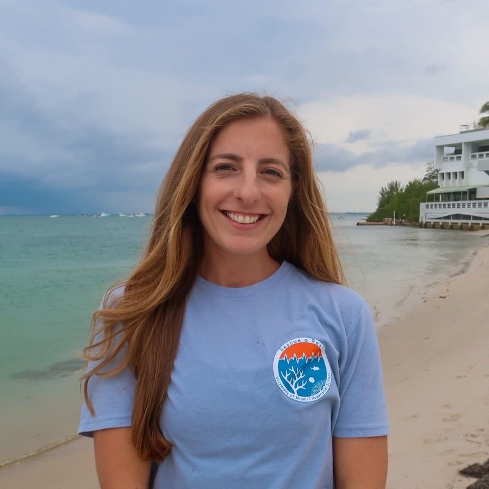

```{=html}
<div class="bg-video" style="background-image: url('assets/bg.jpg');">
  <video class="bg-video__media" autoplay muted loop playsinline poster="assets/bg.jpg">
    <source src="assets/video/bg.mp4" type="video/mp4">
  </video>
</div>
```

::: {.hero-card}

{.headshot fig-alt="Allyson DeMerlis on a beach in Miami"}

# Allyson DeMerlis, PhD

::: {.tagline}
Coral Reef Molecular Ecologist
:::

Welcome! I'm a marine biologist working to help coral reefs survive a changing ocean. I am an Assistant Scientist in [Dr. Diego Lirman](https://rescueareef.earth.miami.edu/)'s lab at the University of Miami Rosenstiel School, where I study coral resilience to environmental stress to improve the efficacy of restoration efforts.

For my PhD at the University of Miami (2024), advised by [Dr. Ian Enochs](https://www.aoml.noaa.gov/coral-reef-ecosystems/) (NOAA AOML) and [Dr. Nikki Traylor-Knowles](https://www.cnidimmunitylab.com/) (UM), I studied the molecular mechanisms of enhancing coral resilience to thermal stress, testing whether corals can be "stress-hardened" with variable temperature treatments before they are outplanted.

I'm committed to open science: my code lives on [GitHub](https://github.com/ademerlis), and I keep a running [online lab notebook](https://ademerlis.github.io) of my analyses.

::: {.link-buttons}
[<i class="bi bi-envelope"></i> Email](mailto:allyson.demerlis@gmail.com){.btn}
[<i class="bi bi-file-earmark-person"></i> CV](assets/2026_DeMerlis_CV.pdf){.btn}
[<i class="bi bi-github"></i> GitHub](https://github.com/ademerlis){.btn}
[<i class="bi bi-journal-text"></i> Notebook](https://ademerlis.github.io){.btn}
[<i class="bi bi-mortarboard"></i> Google Scholar](https://scholar.google.com/citations?user=XL3gr58AAAAJ&hl=en){.btn}
[<i class="bi bi-linkedin"></i> LinkedIn](https://www.linkedin.com/in/allyson-demerlis/){.btn}
[<i class="bi bi-instagram"></i> Instagram](https://www.instagram.com/dr_ocean_ally/){.btn}
[<i class="bi bi-youtube"></i> YouTube](https://www.youtube.com/@dr_ocean_ally){.btn}
:::

:::
