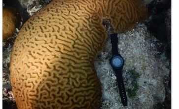
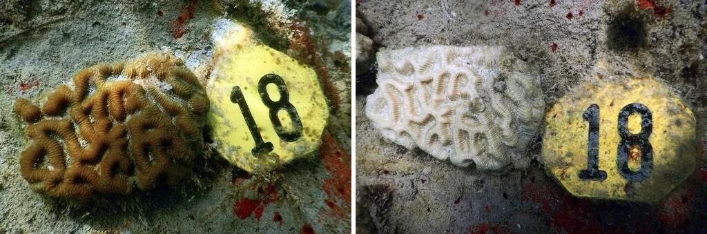
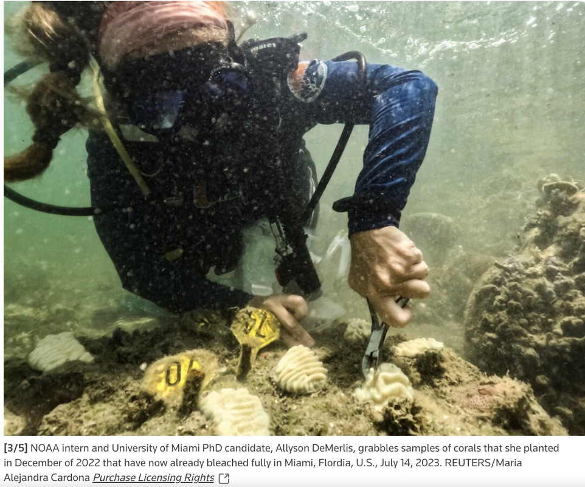
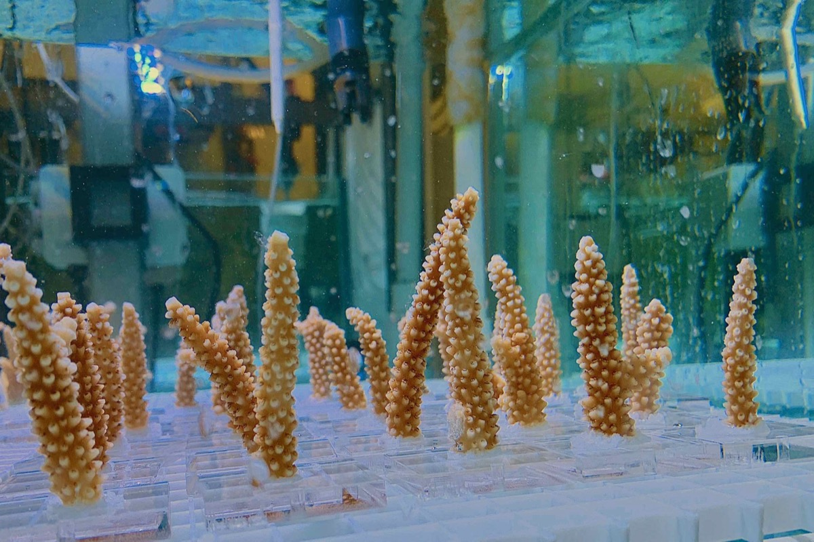
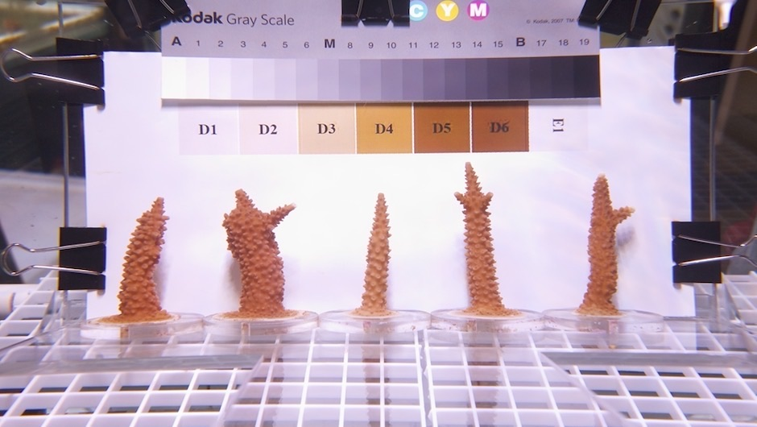

:::: {.pub-grid .column-page}

::: {.pub}
::: {.press-thumb-wrap}
[{fig-alt="Brain coral with a dive computer"}](https://www.miamiherald.com/news/local/environment/climate-change/article288677775.html)
:::

::: {.pub-text}
::: {.pub-meta}
Miami Herald · 2024
:::

::: {.pub-title}
[Water temps soar in Florida Keys. Can coral reefs stand another bout of extreme heat?](https://www.miamiherald.com/news/local/environment/climate-change/article288677775.html)
:::
:::
:::

::: {.pub}
::: {.press-thumb-wrap .press-contain}
[{fig-alt="The same tagged brain coral before and after bleaching"}](https://www.cbsnews.com/miami/news/water-at-tip-of-florida-hits-hot-tub-level-may-have-set-world-record-for-warmest-seawater/)
:::

::: {.pub-text}
::: {.pub-meta}
CBS News Miami · 2023
:::

::: {.pub-title}
[South Florida waters hit hot tub level and may have set world record for warmest seawater](https://www.cbsnews.com/miami/news/water-at-tip-of-florida-hits-hot-tub-level-may-have-set-world-record-for-warmest-seawater/)
:::
:::
:::

::: {.pub}
::: {.press-thumb-wrap}
[{fig-alt="Diver working on a coral reef"}](https://www.reuters.com/world/us/floridas-rising-water-temperatures-raise-concerns-health-coral-reefs-scientists-2023-07-15/)
:::

::: {.pub-text}
::: {.pub-meta}
Reuters · 2023
:::

::: {.pub-title}
[Florida's rising water temperatures raise concerns for health of coral reefs, scientists say](https://www.reuters.com/world/us/floridas-rising-water-temperatures-raise-concerns-health-coral-reefs-scientists-2023-07-15/)
:::
:::
:::

::: {.pub}
::: {.press-thumb-wrap}
[{fig-alt="Staghorn coral fragments in experimental tanks"}](https://www.climate.gov/news-features/features/mission-iconic-reefs-noaa-aims-restore-florida-keys-climate-resilient-corals)
:::

::: {.pub-text}
::: {.pub-meta}
NOAA Climate.gov · 2023
:::

::: {.pub-title}
[With 'Mission: Iconic Reefs', NOAA aims to restore Florida Keys with climate-resilient corals](https://www.climate.gov/news-features/features/mission-iconic-reefs-noaa-aims-restore-florida-keys-climate-resilient-corals)
:::
:::
:::

::: {.pub}
::: {.press-thumb-wrap}
[{fig-alt="Staghorn coral fragments photographed against a color scale"}](https://news.miami.edu/rsmas/stories/2022/03/corals-can-be-trained-to-tolerate-heat-stress-study-finds.html)
:::

::: {.pub-text}
::: {.pub-meta}
University of Miami Rosenstiel School News · 2022
:::

::: {.pub-title}
[Corals can be 'trained' to tolerate heat stress, study finds](https://news.miami.edu/rsmas/stories/2022/03/corals-can-be-trained-to-tolerate-heat-stress-study-finds.html)
:::
:::
:::

::: {.pub}
::: {.press-thumb-wrap}
::: {.press-placeholder}
NBC News WFLA
:::
:::

::: {.pub-text}
::: {.pub-meta}
NBC News WFLA Tampa · 2022
:::

::: {.pub-title}
[New technique shows promise to restore Florida's threatened coral](https://www.wfla.com/weather/new-technique-shows-promise-to-restore-floridas-threatened-coral/)
:::
:::
:::

::::
