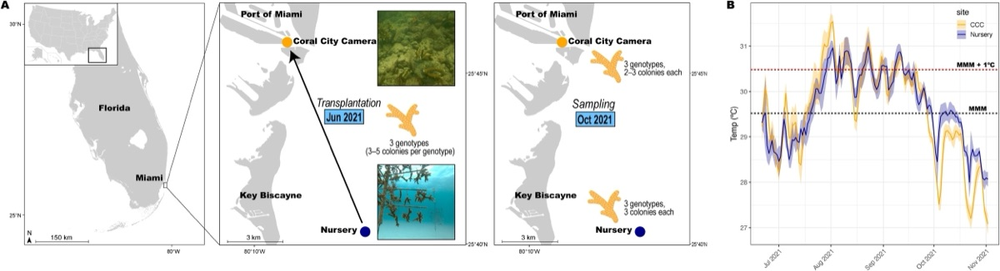
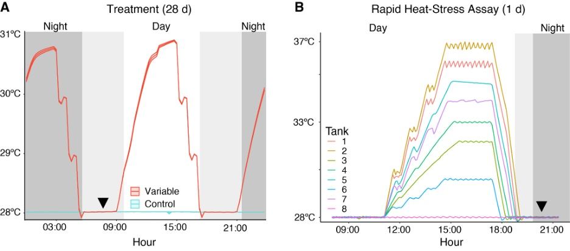
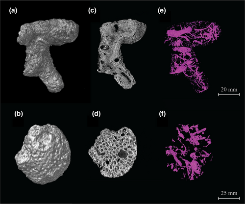
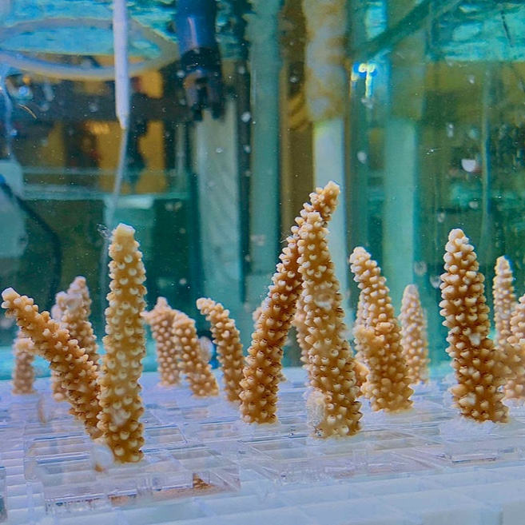
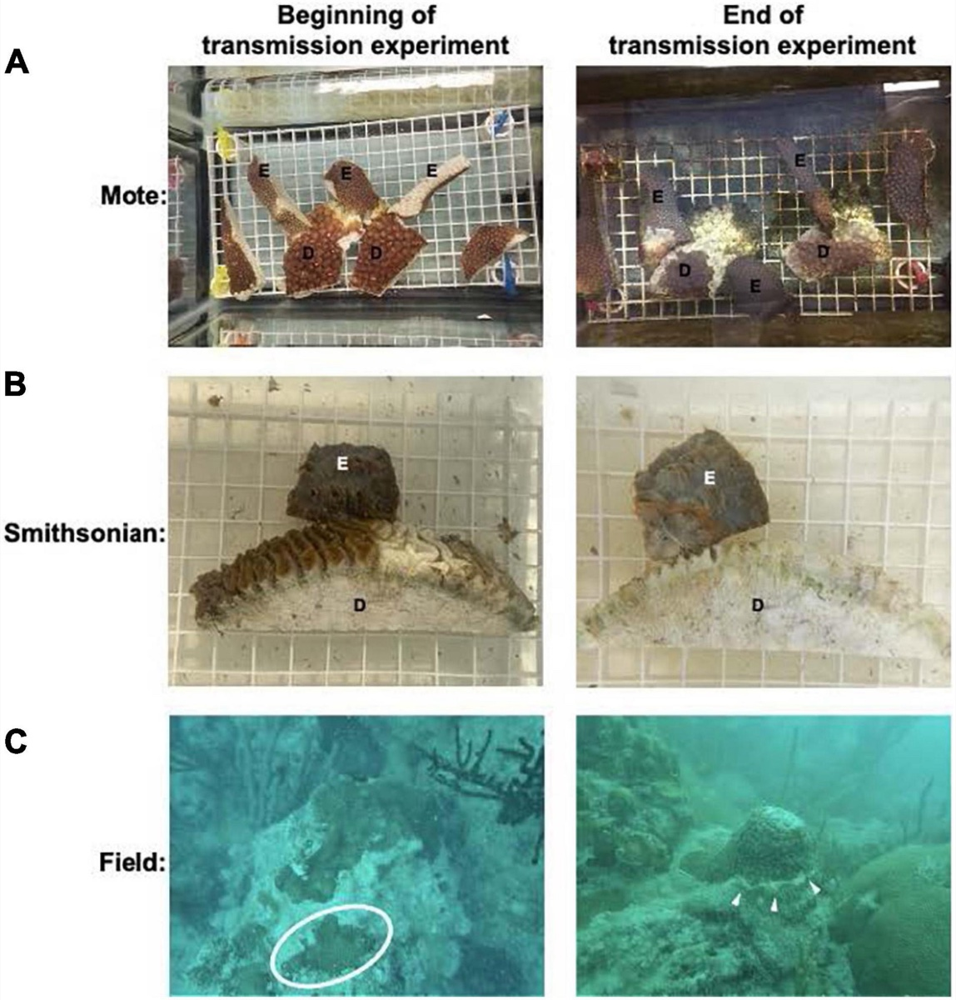
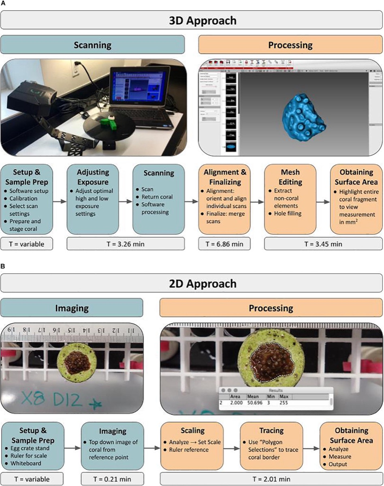

::: {.pub-links}
[<i class="bi bi-mortarboard"></i> Google Scholar](https://scholar.google.com/citations?user=XL3gr58AAAAJ&hl=en){.btn .btn-outline-primary}
[<i class="bi bi-person-badge"></i> ORCID](https://orcid.org/0000-0002-6408-187X){.btn .btn-outline-primary}
[<i class="bi bi-github"></i> Code on GitHub](https://github.com/ademerlis){.btn .btn-outline-primary}
:::

## Peer-reviewed

:::: {.pub-grid .column-page}

::: {.pub}
{.pub-thumb .pub-wide fig-alt="Figure 1: map of study sites and experimental design"}

::: {.pub-text}
::: {.pub-meta}
*Frontiers in Marine Science* · 2026
:::

::: {.pub-title}
[Molecular mechanisms of *Acropora cervicornis* following transplantation to a marginal, nearshore environment](https://doi.org/10.3389/fmars.2026.1796814)
:::

::: {.pub-summary}
Staghorn coral outplanted from an offshore nursery to the urbanized Port of Miami showed sustained activation of stress- and immune-related genes four months after transplantation, consistent with ongoing acclimatization. Pairing molecular diagnostics with environmental monitoring could refine genotype and site selection for restoration.
:::

::: {.pub-cite}
**DeMerlis A**, Foord C, Hesley DJ, Karp RF, Isma LM, Andrade-Rodriguez N, Wong KH, Studivan MS, Jankulak M, Baker AC, Lirman D, Traylor-Knowles N, Enochs IC (2026) Molecular mechanisms of *Acropora cervicornis* following transplantation to a marginal, nearshore environment. *Frontiers in Marine Science*. [doi:10.3389/fmars.2026.1796814](https://doi.org/10.3389/fmars.2026.1796814)
:::
:::
:::

::: {.pub}
{.pub-thumb .pub-wide fig-alt="Variable temperature treatment and rapid heat-stress assay profiles"}

::: {.pub-text}
::: {.pub-meta}
*Ecology and Evolution* · 2025
:::

::: {.pub-title}
[Differences in molecular responses to a thermally variable preconditioning treatment for two Caribbean coral species](https://doi.org/10.1002/ece3.72108)
:::

::: {.pub-summary}
A variable temperature preconditioning treatment changed gene expression far more in staghorn coral (583 genes) than in knobby brain coral (55 genes), including downregulation of key stress-response genes. These species-specific responses mean preconditioning should be tested across more species before it is used at restoration scale.
:::

::: {.pub-cite}
**DeMerlis A**, Studivan M, Wong K, Soderberg N, Ehrens D, Isma L, Coscon K, Rosing K, Thomas R, D'Alessandro M, Dvorkin D, Unsworth J, Kiel P, Palacio-Castro A, Lirman D, Baker A, Muller E, Traylor-Knowles N, Enochs IC (2025) Differences in molecular responses to a thermally variable preconditioning treatment for two Caribbean coral species. *Ecology and Evolution*. [doi:10.1002/ece3.72108](https://doi.org/10.1002/ece3.72108)
:::
:::
:::

::: {.pub}
{.pub-thumb fig-alt="CT scans of coral rubble showing skeletal density and bioerosion"}

::: {.pub-text}
::: {.pub-meta}
*Global Change Biology* · 2024
:::

::: {.pub-title}
[Rubble persistence under Ocean Acidification threatened by accelerated bioerosion and lower-density coral skeletons](https://doi.org/10.1111/gcb.17371)
:::

::: {.pub-summary}
Coral rubble exposed to ocean acidification for 55 days lost carbonate faster, driven by more chemical dissolution and less secondary calcification. Lower-density skeletons were bioeroded faster, a concern because corals build less dense skeletons under acidification.
:::

::: {.pub-cite}
Webb AE, Palacio-Castro AM, Cooke K, Eaton KR, Chomitz B, Soderberg N, Chakraborty M, Zagon Z, Boyd A, Kiel PM, **DeMerlis A**, Perry CT, Enochs IC (2024) Rubble persistence under Ocean Acidification threatened by accelerated bioerosion and lower-density coral skeletons. *Global Change Biology*. [doi:10.1111/gcb.17371](https://doi.org/10.1111/gcb.17371)
:::
:::
:::

::: {.pub}
{.pub-thumb fig-alt="Staghorn coral fragments in experimental tanks"}

::: {.pub-text}
::: {.pub-meta}
*Coral Reefs* · 2022
:::

::: {.pub-title}
[Pre-exposure to a variable temperature treatment improves the response of *Acropora cervicornis* to acute thermal stress](https://doi.org/10.1007/s00338-022-02232-z)
:::

::: {.pub-summary}
Nursery-raised staghorn coral pre-exposed to a variable temperature regime (oscillating twice daily from 28 to 31 °C) endured heat stress several days longer than untreated corals, supporting thermal variability as a tool for stress-hardening corals for restoration.
:::

::: {.pub-cite}
**DeMerlis A**, Kirkland A, Kaufman ML, Mayfield AB, Formel N, Kolodziej G, Manzello DP, Lirman D, Traylor-Knowles N, Enochs IC (2022) Pre-exposure to a variable temperature treatment improves the response of *Acropora cervicornis* to acute thermal stress. *Coral Reefs*. [doi:10.1007/s00338-022-02232-z](https://doi.org/10.1007/s00338-022-02232-z)
:::
:::
:::

::: {.pub}
{.pub-thumb fig-alt="Corals at the beginning and end of the SCTLD transmission experiments"}

::: {.pub-text}
::: {.pub-meta}
*Frontiers in Marine Science* · 2021
:::

::: {.pub-title}
[Gene expression response to stony coral tissue loss disease transmission in *M. cavernosa* and *O. faveolata* from Florida](https://doi.org/10.3389/fmars.2021.681563)
:::

::: {.pub-summary}
Transcriptomes from three stony coral tissue loss disease (SCTLD) transmission experiments at the Smithsonian Marine Station and Mote Marine Laboratory show that *Orbicella faveolata* and *Montastraea cavernosa* mount immune, apoptosis, and tissue-rearrangement responses to SCTLD.
:::

::: {.pub-cite}
Traylor-Knowles N, Connelly MT, Young BD, Eaton K, Muller EM, Paul VJ, Ushijima B, **DeMerlis A**, Drown MK, Goncalves A, Kron N, Snyder GA, Martin C, Rodriguez K (2021) Gene expression response to stony coral tissue loss disease transmission in *M. cavernosa* and *O. faveolata* from Florida. *Frontiers in Marine Science*. [doi:10.3389/fmars.2021.681563](https://doi.org/10.3389/fmars.2021.681563)
:::
:::
:::

::: {.pub}
{.pub-thumb fig-alt="Workflow for 3D scanning coral microfragments"}

::: {.pub-text}
::: {.pub-meta}
*Frontiers in Marine Science* · 2021
:::

::: {.pub-title}
[3D scanning as a tool to measure growth rates of live coral microfragments used for coral reef restoration](https://doi.org/10.3389/fmars.2021.623645)
:::

::: {.pub-summary}
A streamlined workflow uses a structured-light 3D scanner to measure the live tissue surface area of coral microfragments over time. Compared with traditional 2D methods, the 3D approach allows greater standardization across studies, making it a better tool for restoration practitioners.
:::

::: {.pub-cite}
Koch HR, Wallace B, **DeMerlis A**, Clark AS, Nowicki RJ (2021) 3D scanning as a tool to measure growth rates of live coral microfragments used for coral reef restoration. *Frontiers in Marine Science*. [doi:10.3389/fmars.2021.623645](https://doi.org/10.3389/fmars.2021.623645)
:::
:::
:::

::::

## In review

::: {.pub-plain}
::: {.pub-meta}
*Scientific Reports* · in review
:::

::: {.pub-title}
Coral predation across multiple gradients: Implications for survivorship and reef restoration
:::

::: {.pub-cite}
**DeMerlis A**, McAnally A, Bourque A, D'Alessandro M, Gilliam DS, Muller EM, Parsons KT, Sharp WC, Voss JD, Lirman D (2026) Coral predation across multiple gradients: Implications for survivorship and reef restoration. *Scientific Reports*, in review.
:::
:::

::: {.pub-plain}
::: {.pub-meta}
*Bulletin of Marine Science* · in review
:::

::: {.pub-title}
The secret life of coral predators: Documenting fish corallivory on restored corals in Florida using Coral-Baited Remote Underwater Video Systems (C-BRUVS)
:::

::: {.pub-cite}
**DeMerlis A**, Weisman E, D'Alessandro M, Tobias B, Unsworth J, Lirman D (2026) The secret life of coral predators: Documenting fish corallivory on restored corals in Florida using Coral-Baited Remote Underwater Video Systems (C-BRUVS). *Bulletin of Marine Science*, in review.
:::
:::

::: {.pub-plain}
::: {.pub-meta}
*PLOS One* · in review
:::

::: {.pub-title}
The coral innate immune system is activated in the early hours following injury
:::

::: {.pub-cite}
**DeMerlis A**, Rodriguez K, Traylor-Knowles N (2026) The coral innate immune system is activated in the early hours following injury. *PLOS One*, in review.
:::
:::
