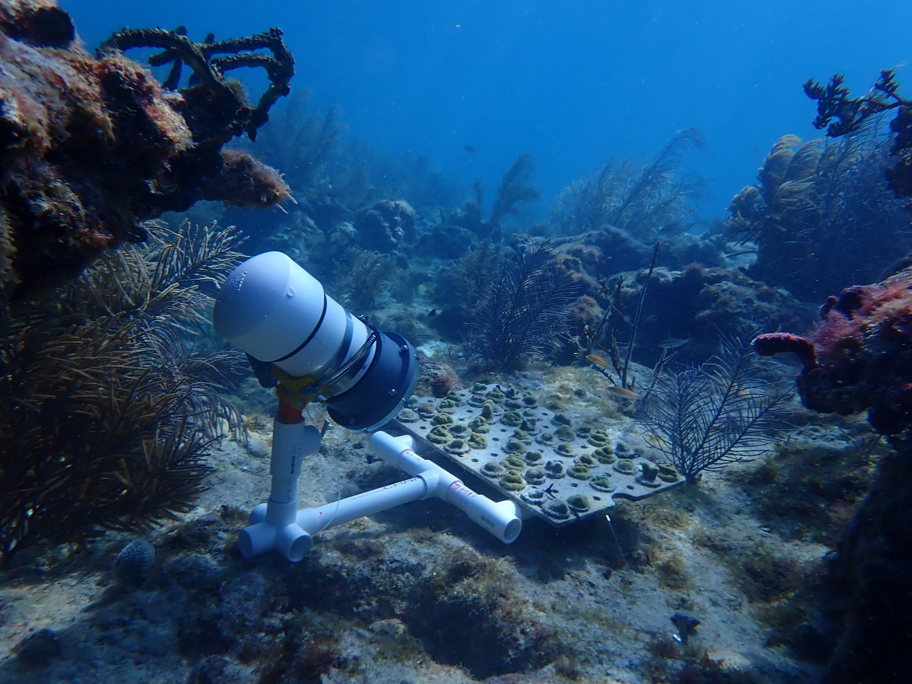
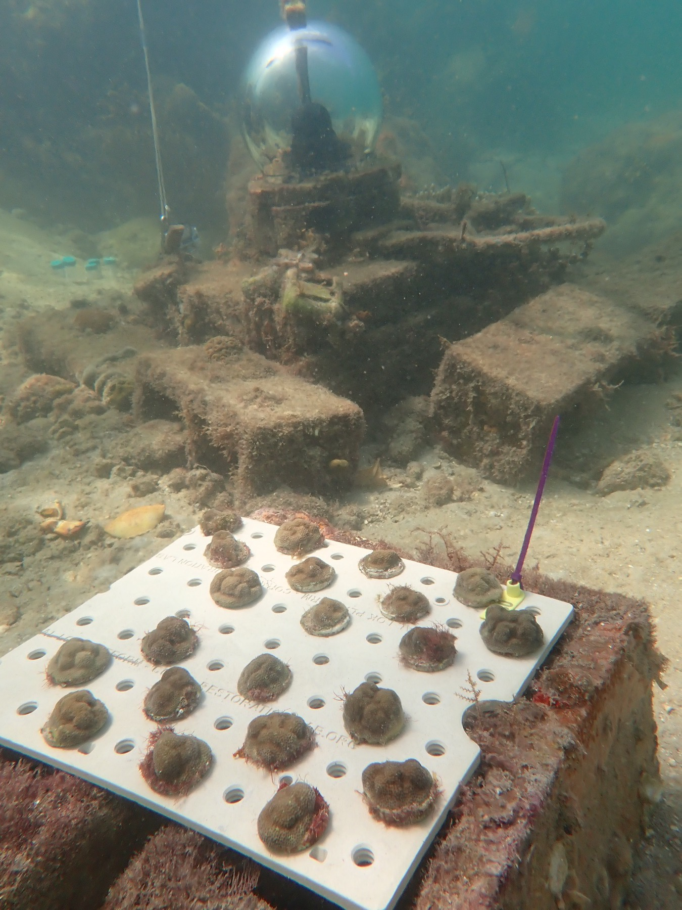
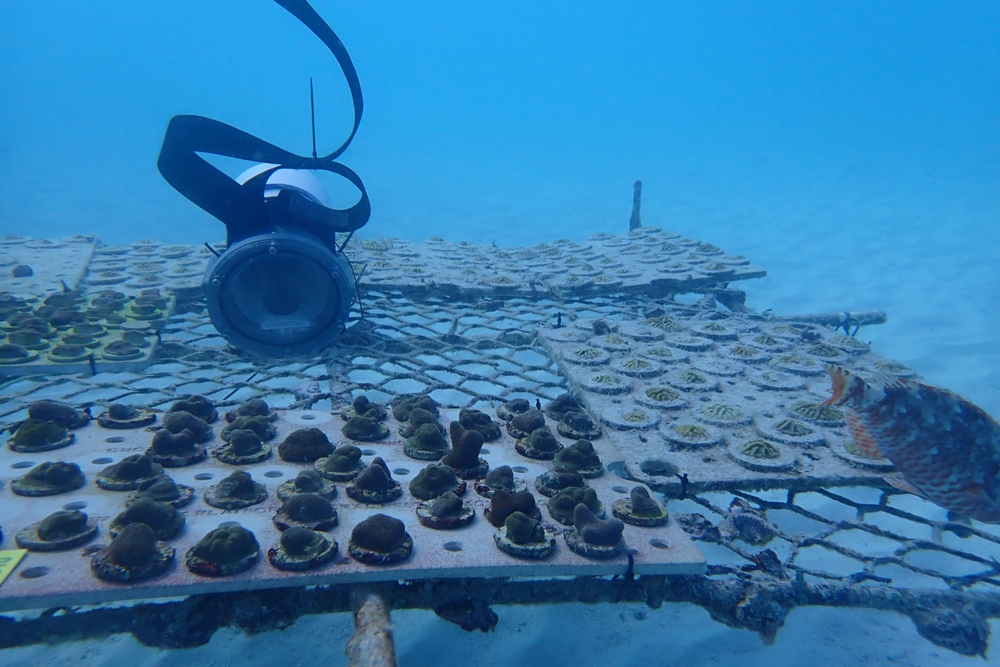
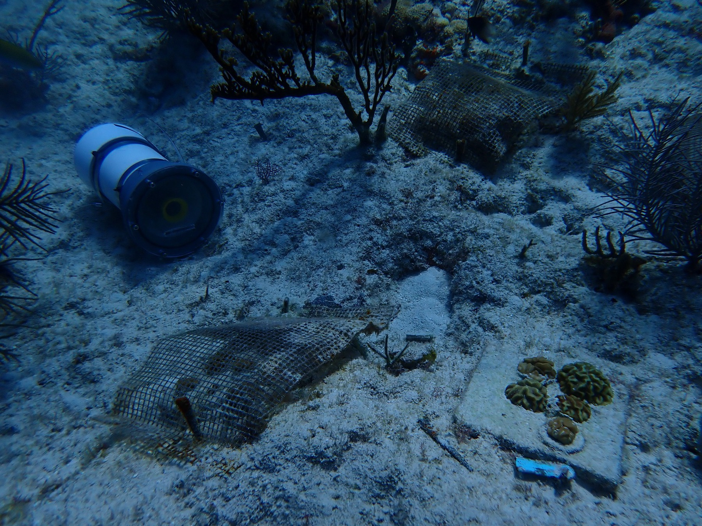
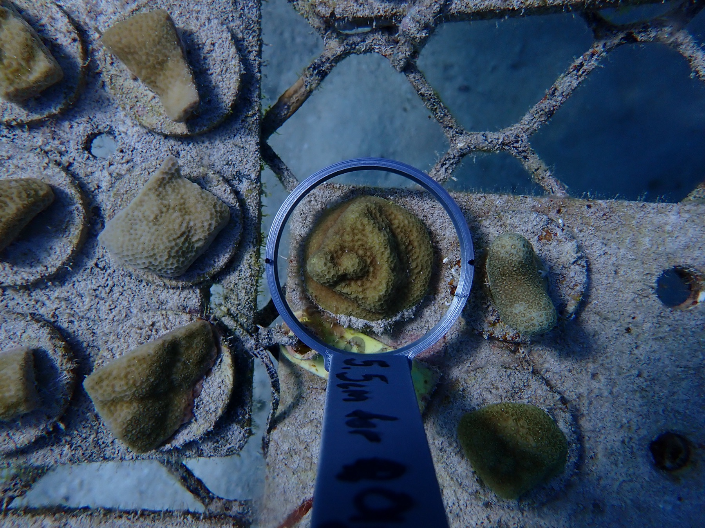
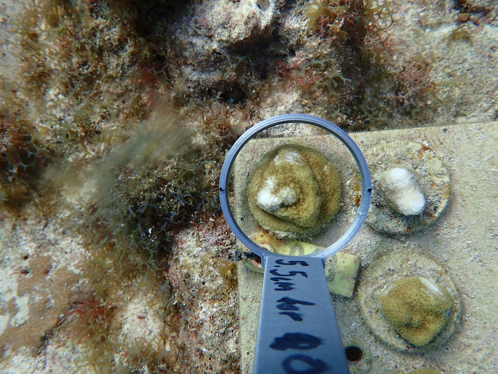
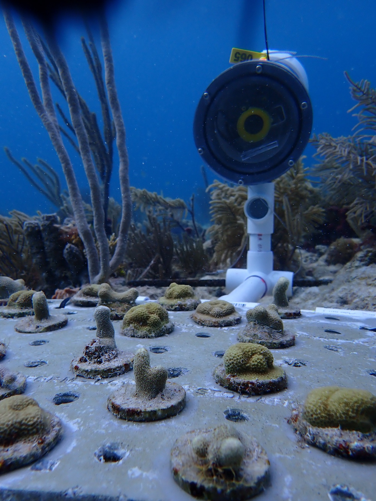
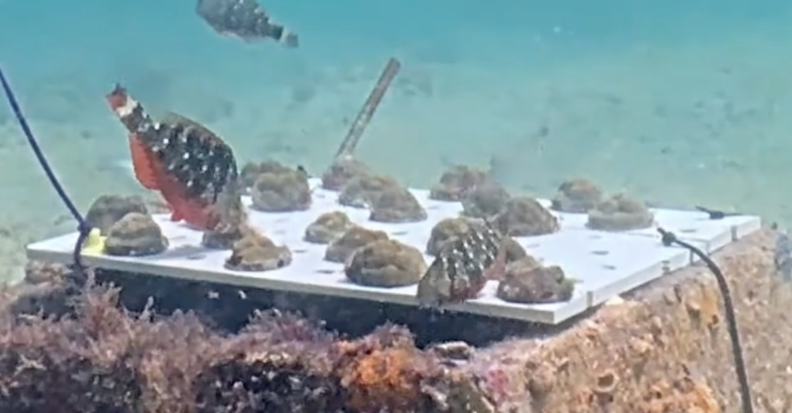

::: {.research-meta}
[Positions]{.meta-label} Assistant Scientist (2026–present)\
[]{.meta-label} Postdoctoral Research Associate (2025–2026)

[Lab]{.meta-label} [Dr. Diego Lirman](https://rescueareef.earth.miami.edu/)'s lab
:::

Large numbers of corals are being outplanted onto Florida's Coral Reef, but many are lost to corallivorous fish soon after they are planted. My research quantifies where, when, and how strongly fish predation affects outplanted corals, so that restoration practitioners can plan around it.

- **Coral-Baited Remote Underwater Video Systems (C-BRUVS).** Documenting fish corallivory on restored corals in Florida with underwater video.
- **A predation pressure index.** Co-PI on a Florida Department of Environmental Protection meta-analysis integrating field data to quantify corallivorous fish impacts on outplant success through a spatiotemporal predation pressure index. [<i class="bi bi-file-earmark-pdf"></i> Read the final report](https://floridadep.gov/sites/default/files/DeMerlis_DEP_Final%20Report.pdf)
- **Predictive tools and experimental validation.** As PI on a follow-up DEP project, I am integrating predation data into predictive tools and testing them in the field.

## Coral-Baited Remote Underwater Video Systems (C-BRUVS)

::::: {.photo-row .photo-banner}

::: {.rphoto style="flex: 1.333 1 0"}
{group="current" description="A C-BRUVS camera recording outplanted corals at Oasis (Deployment 4)" fig-alt="A C-BRUVS camera recording outplanted corals at Oasis"}

[A C-BRUVS camera recording outplanted corals at Oasis (Deployment 4)]{.rcap}
:::

:::::

::::: {.photo-row}

::: {.rphoto style="flex: 0.750 1 0"}
{group="current" description="Deployment 1: *Porites astreoides* outplants at CCC" fig-alt="Deployment 1: Porites astreoides outplants at CCC"}

[Deployment 1: *Porites astreoides* outplants at CCC]{.rcap}
:::

::: {.rphoto style="flex: 1.498 1 0"}
{group="current" description="Deployment 2: Paradise Nursery" fig-alt="Deployment 2: Paradise Nursery"}

[Deployment 2: Paradise Nursery]{.rcap}
:::

::: {.rphoto style="flex: 1.333 1 0"}
{group="current" description="Deployment 3: *Pseudodiploria strigosa* outplants before cage removal" fig-alt="Deployment 3: Pseudodiploria strigosa outplants before cage removal"}

[Deployment 3: *Pseudodiploria strigosa* outplants before cage removal]{.rcap}
:::

:::::

::::: {.photo-row}

::: {.rphoto style="flex: 1.333 1 0"}
{group="current" description="Deployment 4: *P. astreoides* outplant PAST03 at Oasis, initial" fig-alt="Deployment 4: Porites astreoides outplant PAST03 at Oasis, initial"}

[Deployment 4: *P. astreoides* outplant PAST03 at Oasis, initial]{.rcap}
:::

::: {.rphoto style="flex: 1.333 1 0"}
{group="current" description="The same outplant after 4 days" fig-alt="The same Porites astreoides outplant after 4 days"}

[The same outplant after 4 days]{.rcap}
:::

:::::

::::: {.photo-row}

::: {.rphoto style="flex: 0.750 1 0"}
{group="current" description="Deployment 5: Paradise" fig-alt="Deployment 5: Paradise"}

[Deployment 5: Paradise]{.rcap}
:::

::: {.rphoto style="flex: 1.915 1 0"}
{group="current" description="A parrotfish visiting *P. astreoides* outplants at CCC" fig-alt="A parrotfish visiting Porites astreoides outplants at CCC"}

[A parrotfish visiting *P. astreoides* outplants at CCC]{.rcap}
:::

:::::
