::: {.research-meta}
[Positions]{.meta-label} Coral Health and Disease Intern (Feb–May 2019)\
[]{.meta-label} Research Intern (May–Aug 2019)

[Advisors]{.meta-label} Dr. Hanna Koch and Dr. Abigail Clark
:::

At Mote's International Center for Coral Reef Research and Restoration, I cared for thousands of corals in the ex-situ nursery, including *A. cervicornis* sexual recruits, and helped build Mote's first *in-situ* spawning nursery for *A. cervicornis*. I also extracted DNA from healthy and diseased corals for stony coral tissue loss disease (SCTLD) research.

For my independent project, I developed a protocol for measuring coral microfragment growth with a structured-light 3D scanner, published in [*Frontiers in Marine Science*](https://doi.org/10.3389/fmars.2021.623645).

I was an intern in the Coral Health and Disease Program at Mote Marine Laboratory's research facility in the Florida Keys from February to August 2019. While there, I was supervised by Dr. Abigail Clark and Dr. Hanna Koch, who taught me so much about corals!

::::: {.photo-row}

::: {.rphoto style="flex: 1.028 1 0"}
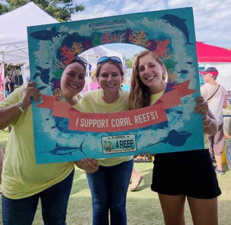{group="mote" description="Lygia Bolden, Dr. Abigail Clark, and I at Mote's Ocean Fest in Key West!" fig-alt="Lygia Bolden, Dr. Abigail Clark, and I at Mote's Ocean Fest in Key West!"}

[Lygia Bolden, Dr. Abigail Clark, and I at Mote's Ocean Fest in Key West!]{.rcap}
:::

::: {.rphoto style="flex: 0.751 1 0"}
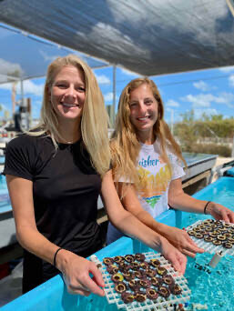{group="mote" description="Dr. Hanna Koch and myself showing off the baby corals!" fig-alt="Dr. Hanna Koch and myself showing off the baby corals!"}

[Dr. Hanna Koch and myself showing off the baby corals!]{.rcap}
:::

::: {.rphoto style="flex: 0.750 1 0"}
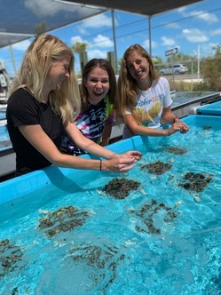{group="mote" description="Dr. Hanna Koch, Dr. Abigail Clark, and myself - can you tell how much we love corals?" fig-alt="Dr. Hanna Koch, Dr. Abigail Clark, and myself - can you tell how much we love corals?"}

[Dr. Hanna Koch, Dr. Abigail Clark, and myself - can you tell how much we love corals?]{.rcap}
:::

:::::

### Coral Husbandry

A big part of the Mote research facility in the Florida Keys involves daily care, or husbandry, of the corals that are kept in the ex-situ (out-of-ocean) nursery. There are thousands of corals kept across the many raceways that hold the corals, and these mini-habitats require daily cleaning to remove algae and to keep the corals happy and healthy. In addition to this, Mote pioneered the micro-fragmentation technique, which involves the fine cutting of bouldering coral species into very small fragments, affixing them onto cement plugs so that they can regrow, and then out-planting these corals back onto native reef sites in arrays such that the corals can regrow to a larger size much faster than they normally could.

::::: {.photo-row .photo-banner}

::: {.rphoto style="flex: 1.334 1 0"}
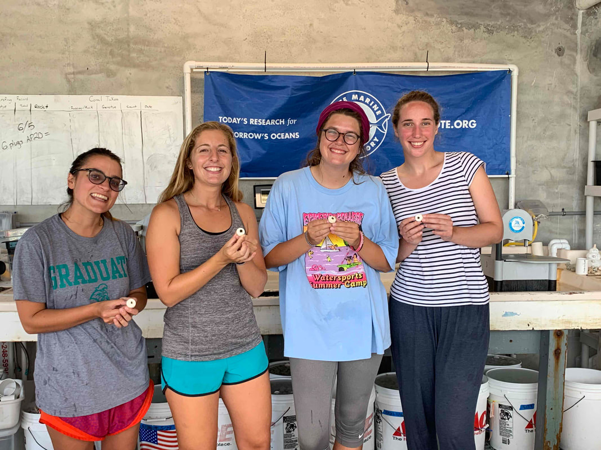{group="mote" description="Sam Cook, myself, Trish Schranck, and Marina Villoch showing off our freshly micro-fragmented corals for Trish's experiment." fig-alt="Sam Cook, myself, Trish Schranck, and Marina Villoch showing off our freshly micro-fragmented corals for Trish's experiment."}

[Sam Cook, myself, Trish Schranck, and Marina Villoch showing off our freshly micro-fragmented corals for Trish's experiment.]{.rcap}
:::

:::::

Micro-fragmentation works in a similar way to our skin healing after a cut - tissue regrows much more quickly to heal the wound that was made. In this way, faster coral growth is promoted. Normally, an individual boulder coral would take many years to grow to a large size. The scientific article describing this process can be found here: <https://peerj.com/articles/1313/> In addition to many small fragments, a subset of the corals cared for at Mote are offspring from adult corals that have spawned in the Caribbean. The two images below show juvenile recruits of *Acropora cervicornis*, a critically endangered species of reef-building coral.

::::: {.photo-row}

::: {.rphoto style="flex: 0.751 1 0"}
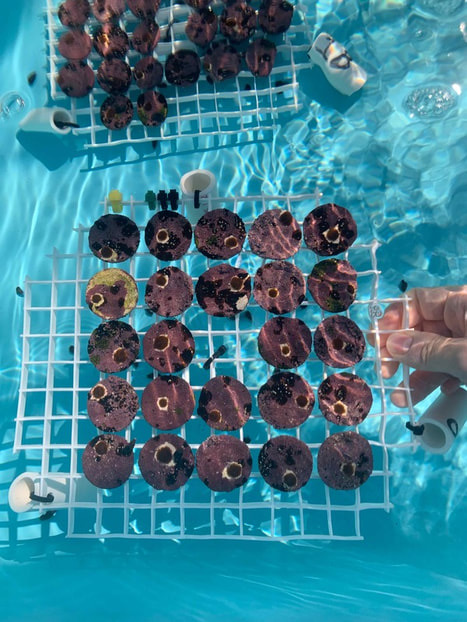{group="mote" description="The baby corals I took care of every day! The tiny brown circles are *Acropora cervicornis* sexual recruits - this means that they are baby corals that are the result of a coral spawning event. Each is their own distinct genetic entity. In this photo, they are about 4 months old!" fig-alt="The baby corals I took care of every day! The tiny brown circles are Acropora cervicornis sexual recruits - this means that they are baby corals that are the result of a coral spawning event. Each is their own distinct genetic entity. In this photo, they are about 4 months old!"}

[The baby corals I took care of every day! The tiny brown circles are *Acropora cervicornis* sexual recruits - this means that they are baby corals that are the result of a coral spawning event. Each is their own distinct genetic entity. In this photo, they are about 4 months old!]{.rcap}
:::

::: {.rphoto style="flex: 0.750 1 0"}
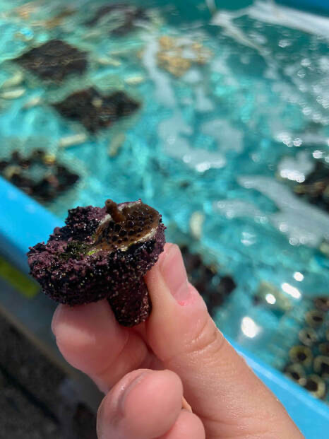{group="mote" description="A close-up of a baby coral growing their first branch! I was such a proud coral mom." fig-alt="A close-up of a baby coral growing their first branch! I was such a proud coral mom."}

[A close-up of a baby coral growing their first branch! I was such a proud coral mom.]{.rcap}
:::

::: {.rphoto style="flex: 0.751 1 0"}
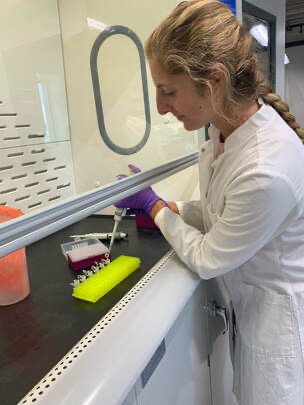{group="mote" description="Photo by Lygia Bolden" fig-alt="Photo by Lygia Bolden"}

[Photo by Lygia Bolden]{.rcap}
:::

:::::

### DNA Extractions

One of my tasks as an intern was to assist in extracting DNA from coral tissue samples of healthy and diseased colonies along the Florida Reef Tract. Stony coral tissue loss disease (SCTLD) has been one of the most deadly diseases for the corals of the Caribbean. It emerged in 2014 in Miami and has since spread to other Caribbean countries. The disease affects 20 different coral species and has rapidly spreads across the colony. Because of this, many researchers, including Dr. Abigail Clark and Dr. Erinn Muller at Mote Marine Laboratory, are investigating what bacterial or viral agents are causing this disease. These extractions will be sequenced in the hopes of identifying common pathogens across different infected coral species.

Photo from the Stony Coral Tissue Loss Disease workshop, in Key West, FL, with representatives and researchers from Florida and the U.S. Virgin Islands, where the disease has also spread. Efforts from this workshop included sharing information on methods for treating and monitoring the disease, as well as future directions.

::::: {.photo-row .photo-banner}

::: {.rphoto style="flex: 1.587 1 0"}
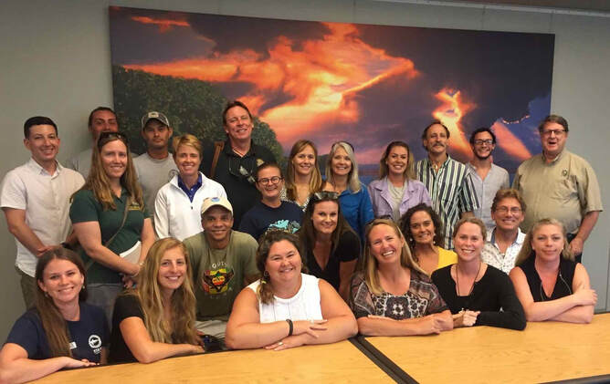{group="mote"}
:::

:::::

### Coral Restoration

I also assisted the restoration team at Mote in assembling their first *Acropora cervicornis* spawning nursery. Coral spawning is how corals sexually reproduce, and having this nursery will allow for the generation of new genotypes in a controlled setting. These new genotypes provide the necessary diversity for a healthy coral reef population, and also offer opportunities to discover new genotypes that may perform better under certain environmental stressors, such as warming ocean temperatures.

::::: {.photo-row}

::: {.rphoto style="flex: 1.521 1 0"}
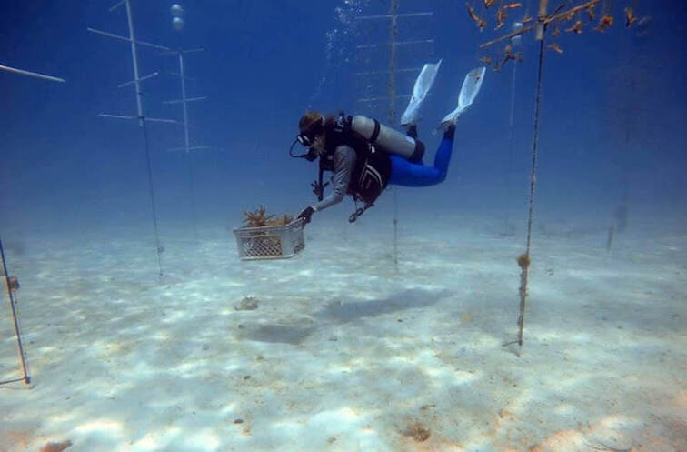{group="mote" description="Photo by Dr. Hanna Koch - collecting corals of a larger size to dedicate to the coral spawning nursery" fig-alt="Photo by Dr. Hanna Koch - collecting corals of a larger size to dedicate to the coral spawning nursery"}

[Photo by Dr. Hanna Koch - collecting corals of a larger size to dedicate to the coral spawning nursery]{.rcap}
:::

::: {.rphoto style="flex: 0.750 1 0"}
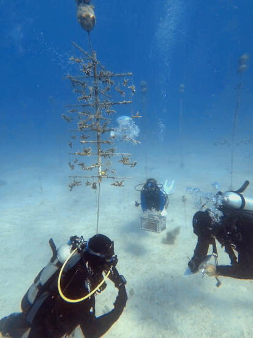{group="mote" description="Photo by Dr. Hanna Koch" fig-alt="Photo by Dr. Hanna Koch"}

[Photo by Dr. Hanna Koch]{.rcap}
:::

:::::

::::: {.photo-row}

::: {.rphoto style="flex: 0.750 1 0"}
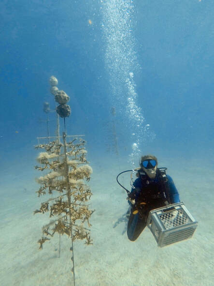{group="mote" description="Photo by Dr. Hanna Koch" fig-alt="Photo by Dr. Hanna Koch"}

[Photo by Dr. Hanna Koch]{.rcap}
:::

::: {.rphoto style="flex: 0.751 1 0"}
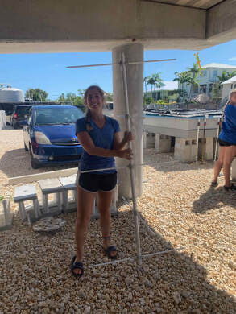{group="mote" description="Building the restoration nursery trees using PVC and epoxy." fig-alt="Building the restoration nursery trees using PVC and epoxy."}

[Building the restoration nursery trees using PVC and epoxy.]{.rcap}
:::

::: {.rphoto style="flex: 1.262 1 0"}
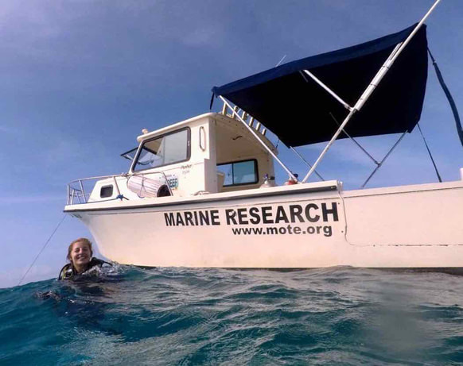{group="mote" description="I am very grateful to have had the opportunity to dive for Mote's research efforts." fig-alt="I am very grateful to have had the opportunity to dive for Mote's research efforts."}

[I am very grateful to have had the opportunity to dive for Mote's research efforts.]{.rcap}
:::

:::::

### Independent Research Project

In addition to my daily tasks, I was funded to conduct an experiment utilizing Mote's new 3D scanner to explore ways in which growth rates may be monitored in a three-dimensional manner. The standard method of growth rate measurement uses the free software, ImageJ, to measure 2D surface area from an aerial view. As different coral species have different growth shapes, such as branching or bouldering, a 3D metric would be very useful in understanding when and how quickly corals begin growing vertically. I developed a protocol for using the 3D scanner with different coral species at Mote and shared some images from this process, depicted below. It was exciting to be a part of this project and learn how to apply a new technology to the coral research field.

::::: {.photo-row}

::: {.rphoto style="flex: 1.334 1 0"}
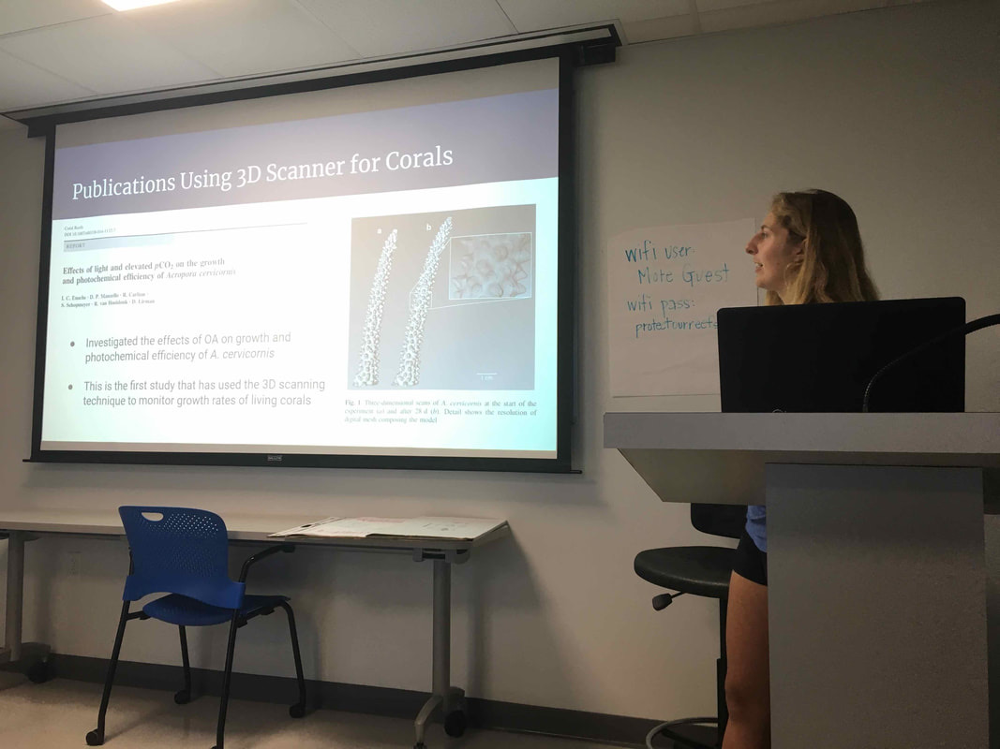{group="mote" description="Presenting my initial findings to the Mote staff and interns." fig-alt="Presenting my initial findings to the Mote staff and interns."}

[Presenting my initial findings to the Mote staff and interns.]{.rcap}
:::

::: {.rphoto style="flex: 1.334 1 0"}
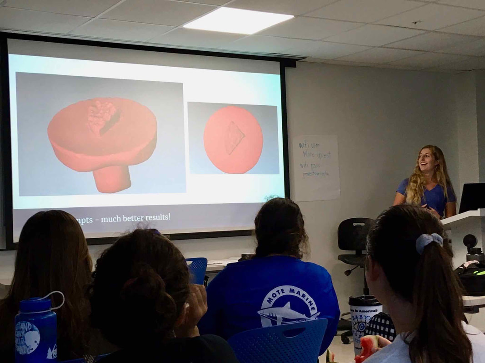{group="mote" description="I was excited when I was finally able to create complete 3D scans!" fig-alt="I was excited when I was finally able to create complete 3D scans!"}

[I was excited when I was finally able to create complete 3D scans!]{.rcap}
:::

:::::

::::: {.photo-row}

::: {.rphoto style="flex: 1.162 1 0"}
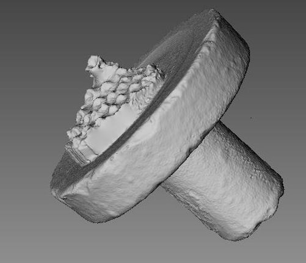{group="mote"}
:::

::: {.rphoto style="flex: 1.011 1 0"}
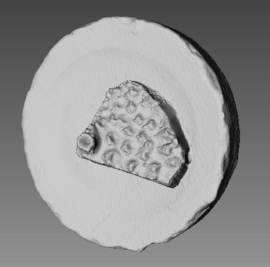{group="mote"}
:::

:::::

A side view and aerial view of an *Acropora cervicornis* fragment - the level of detail where you can see the individual polyp structure was so exciting to me.

### Coral Spawning

After taking care of baby corals for several months, I was eager to be a part of the coral spawning project, led by Dr. Hanna Koch. Coral spawning is the sexual reproduction event that generates new offspring, increasing population size and genetic diversity for a given coral species. Coral spawning is very difficult to monitor; it occurs during the night after the full moon, and the time of year depends on geographic location. In Florida, coral spawning for most species is August - September, so we were preparing to collect in August. But what were we collecting? Well, there are two modes of sexual reproduction for corals - broadcast spawning and brooding. *Acropora cervicornis*, our species of interest, utilize broadcast spawning, which means that on the reef, all adult colonies release gamete bundles (containing both eggs and sperm) at the same exact time. How do they synchronize this event so well? There are many different environmental cues they use to time this event that only happens once per year! The first two images below were taken using corals collected from the field in June. Although the spawning event is in August, corals that are going to spawn that year are preparing for the event many months in advance. Corals that are ready to spawn are typically a certain size (i.e. adults) and have enough nutritional stores and energy to devote to producing these gamete bundles.

::::: {.photo-row}

::: {.rphoto style="flex: 1.278 1 0"}
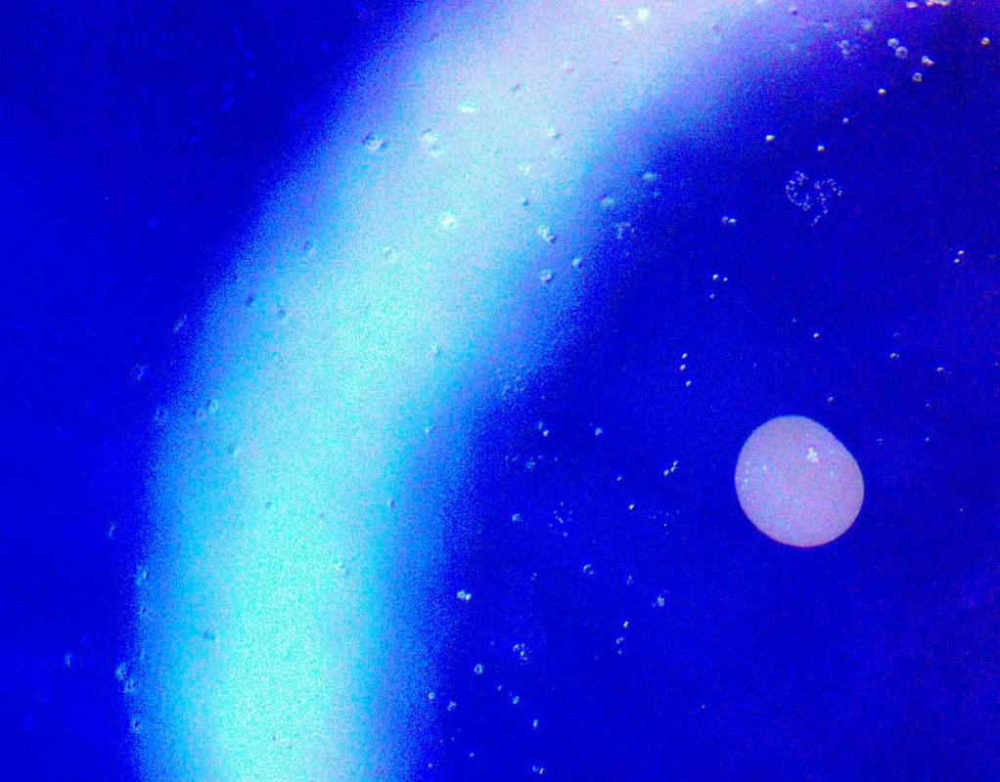{group="mote" description="An isolated gamete bundle under the microscope." fig-alt="An isolated gamete bundle under the microscope."}

[An isolated gamete bundle under the microscope.]{.rcap}
:::

::: {.rphoto style="flex: 1.085 1 0"}
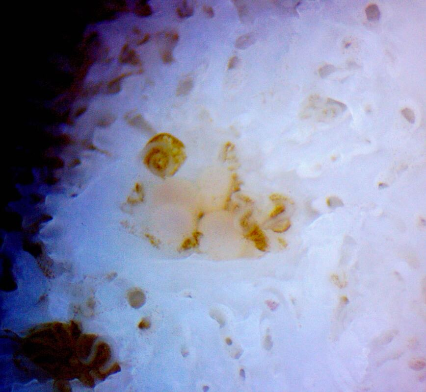{group="mote" description="Gamete bundles stored in the coral's skeletal matrix." fig-alt="Gamete bundles stored in the coral's skeletal matrix."}

[Gamete bundles stored in the coral's skeletal matrix.]{.rcap}
:::

:::::

The first night of spawning took place after we separated each coral colony into their own bucket. We monitored the corals every half hour to look for signs of setting, when the polyps hold the gamete bundles in preparation for their release. Once we started seeing gamete bundles floating to the surface, we collected data and the bundles themselves in order to do controlled crosses in the lab.

::::: {.photo-row}

::: {.rphoto style="flex: 1.334 1 0"}
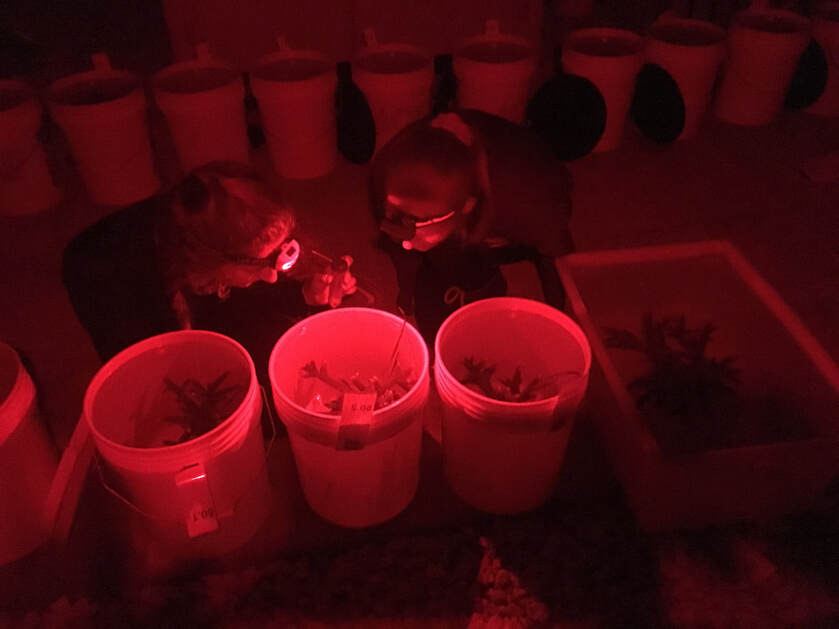{group="mote" description="Photo by Dr. Hanna Koch - Fellow intern Cecile Vimond and I collecting gamete bundles as they float to the surface." fig-alt="Photo by Dr. Hanna Koch - Fellow intern Cecile Vimond and I collecting gamete bundles as they float to the surface."}

[Photo by Dr. Hanna Koch - Fellow intern Cecile Vimond and I collecting gamete bundles as they float to the surface.]{.rcap}
:::

::: {.rphoto style="flex: 0.750 1 0"}
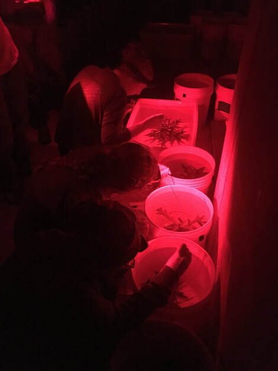{group="mote" description="We had to use red headlamps because bright light can prevent the corals from spawning. On the reef, corals spawn at night and use the full moon as one of their cues. We were trying to mimic their natural environment so they could spawn even on land." fig-alt="We had to use red headlamps because bright light can prevent the corals from spawning. On the reef, corals spawn at night and use the full moon as one of their cues. We were trying to mimic their natural environment so they could spawn even on land."}

[We had to use red headlamps because bright light can prevent the corals from spawning. On the reef, corals spawn at night and use the full moon as one of their cues. We were trying to mimic their natural environment so they could spawn even on land.]{.rcap}
:::

::: {.rphoto style="flex: 0.750 1 0"}
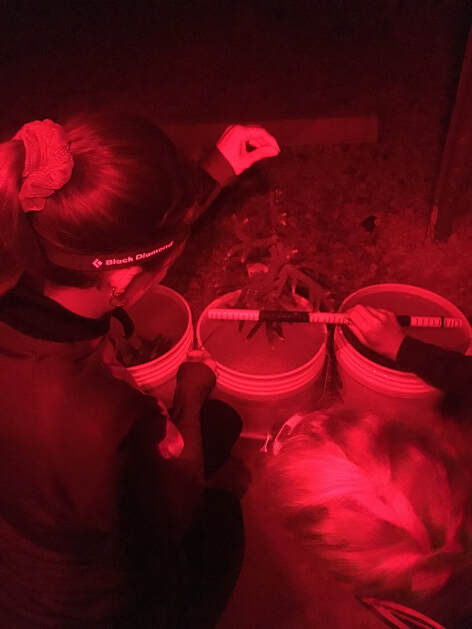{group="mote" description="When a coral spawned, we recorded metrics such as the length and width of the colony in order to understand more about the corals that were successful in spawning." fig-alt="When a coral spawned, we recorded metrics such as the length and width of the colony in order to understand more about the corals that were successful in spawning."}

[When a coral spawned, we recorded metrics such as the length and width of the colony in order to understand more about the corals that were successful in spawning.]{.rcap}
:::

:::::

::::: {.photo-row}

::: {.rphoto style="flex: 1.333 1 0"}
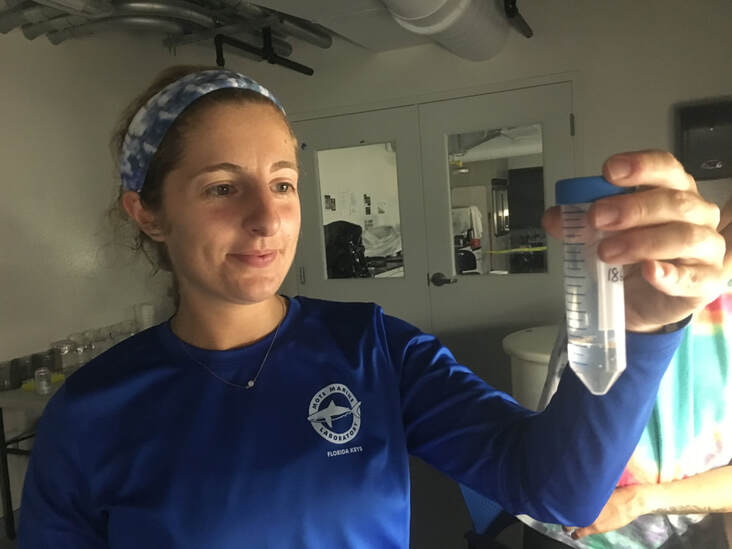{group="mote" description="Photo by Dr. Hanna Koch - In this photo, I'm holding some gamete bundles from one of the *Acropora cervicornis* corals that spawned!" fig-alt="Photo by Dr. Hanna Koch - In this photo, I'm holding some gamete bundles from one of the Acropora cervicornis corals that spawned!"}

[Photo by Dr. Hanna Koch - In this photo, I'm holding some gamete bundles from one of the *Acropora cervicornis* corals that spawned!]{.rcap}
:::

::: {.rphoto style="flex: 1.334 1 0"}
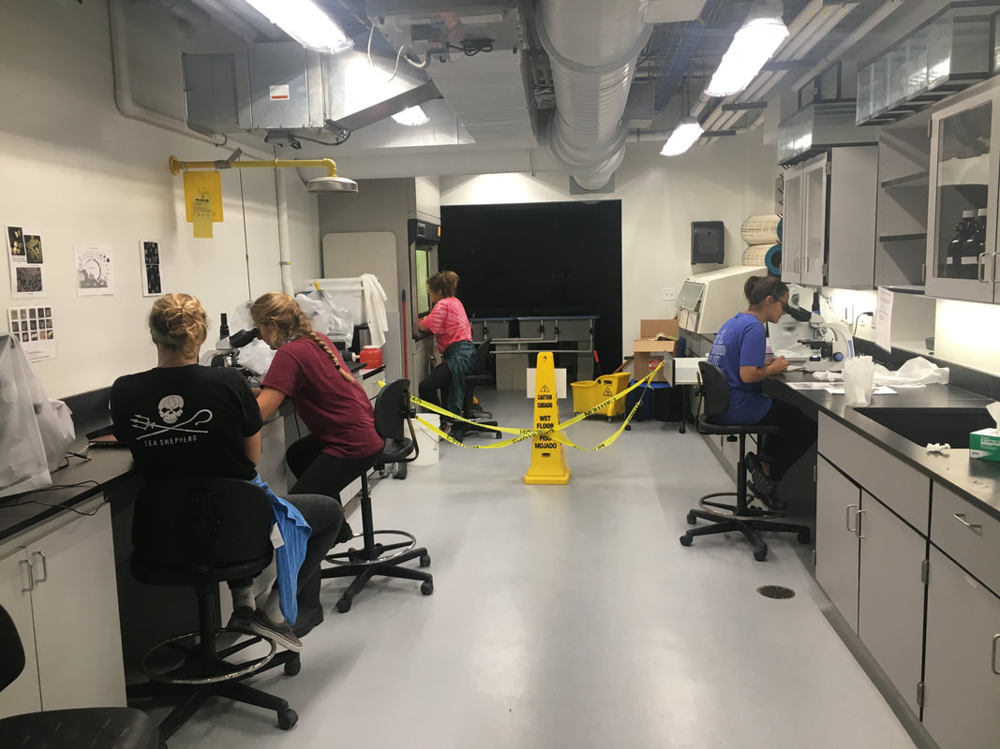{group="mote" description="Photo by Dr. Hanna Koch - Fellow interns (Marina Villoch, Trish Schranck, and Sam Cook) and I doing various tasks related to preservation and quantification of the gamete bundle contents. This helped us determine the correct ratios for doing sperm + egg crosses." fig-alt="Photo by Dr. Hanna Koch - Fellow interns (Marina Villoch, Trish Schranck, and Sam Cook) and I doing various tasks related to preservation and quantification of the gamete bundle contents. This helped us determine the correct ratios for doing sperm + egg crosses."}

[Photo by Dr. Hanna Koch - Fellow interns (Marina Villoch, Trish Schranck, and Sam Cook) and I doing various tasks related to preservation and quantification of the gamete bundle contents. This helped us determine the correct ratios for doing sperm + egg crosses.]{.rcap}
:::

::: {.rphoto style="flex: 0.749 1 0"}
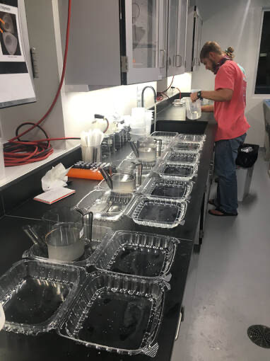{group="mote" description="Coral Reproduction Technician, Cody Engelsma, preparing the crosses of different coral genotypes." fig-alt="Coral Reproduction Technician, Cody Engelsma, preparing the crosses of different coral genotypes."}

[Coral Reproduction Technician, Cody Engelsma, preparing the crosses of different coral genotypes.]{.rcap}
:::

::: {.rphoto style="flex: 1.334 1 0"}
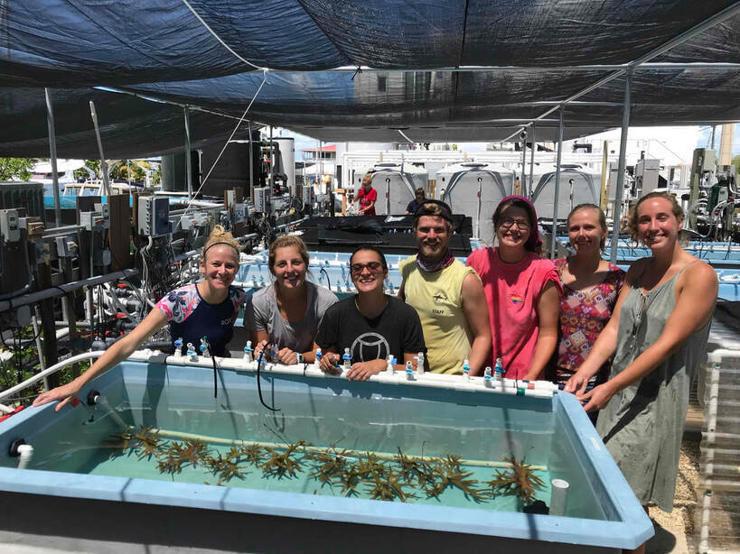{group="mote" description="So proud and happy to have been a part of the Coral Health and Disease spawning crew for summer 2019! It was tough work (a lot of staying up late, because of course the corals wait to spawn until after the full moon), and it was such a rewarding experience." fig-alt="So proud and happy to have been a part of the Coral Health and Disease spawning crew for summer 2019! It was tough work (a lot of staying up late, because of course the corals wait to spawn until after the full moon), and it was such a rewarding experience."}

[So proud and happy to have been a part of the Coral Health and Disease spawning crew for summer 2019! It was tough work (a lot of staying up late, because of course the corals wait to spawn until after the full moon), and it was such a rewarding experience.]{.rcap}
:::

:::::
