::: {.research-meta}
[Degree]{.meta-label} PhD, Marine Biology and Ecology

[Advisors]{.meta-label} [Dr. Ian Enochs](https://www.aoml.noaa.gov/coral-reef-ecosystems/) (NOAA AOML) and [Dr. Nikki Traylor-Knowles](https://www.cnidimmunitylab.com/) (UM)
:::

My dissertation identified molecular pathways involved in thermal stress-hardening of Caribbean corals propagated for restoration in Florida. The goal was to understand the mechanisms of thermal priming so that assisted acclimatization could one day be used as a restoration technique.

We showed in [*Coral Reefs*](https://doi.org/10.1007/s00338-022-02232-z) that pre-exposure to a variable temperature treatment let the critically endangered staghorn coral, *Acropora cervicornis*, endure heat stress for days longer before bleaching. Follow-up work in [*Ecology and Evolution*](https://doi.org/10.1002/ece3.72108) found that the same treatment changed gene expression in *A. cervicornis* but not in *Pseudodiploria clivosa*, highlighting the need for species-specific approaches. I also studied *A. cervicornis* transplanted to a marginal, nearshore environment ([*Frontiers in Marine Science*](https://doi.org/10.3389/fmars.2026.1796814)).

## Experiment 1: Stress-Hardening Using Temperature Variability (2019–2020)

In October 2019, I collected corals from [Dr. Diego Lirman](https://rescueareef.earth.miami.edu/)'s coral nursery for my first experiment, which looked at stress-hardening of different genotypes used in coral restoration efforts. With the help of my lab mates, we collected many coral colonies to bring back to the lab for fragmenting.

::::: {.photo-row}

::: {.rphoto style="flex: 1.333 1 0"}
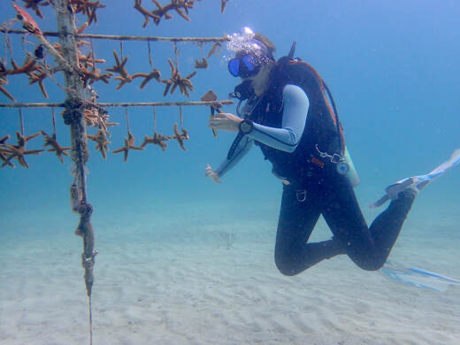{group="phd" description="Photo by Nikki Besemer" fig-alt="Photo by Nikki Besemer"}

[Photo by Nikki Besemer]{.rcap}
:::

::: {.rphoto style="flex: 1.332 1 0"}
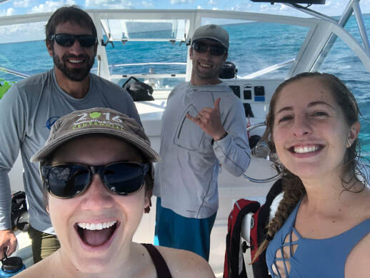{group="phd" description="Dr. Anderson Mayfield, Nate Formel, Nikki Besemer, and myself (NOAA AOML ACCRETE Lab)" fig-alt="Dr. Anderson Mayfield, Nate Formel, Nikki Besemer, and myself (NOAA AOML ACCRETE Lab)"}

[Dr. Anderson Mayfield, Nate Formel, Nikki Besemer, and myself (NOAA AOML ACCRETE Lab)]{.rcap}
:::

:::::

After collecting the coral colonies from the field, they were fragmented and then given time to acclimate to their tanks before the experiment began. The experiment involved a two month stress-hardening treatment. After this variable temperature treatment, all corals were put into a rapid bleaching assay, where the temperature rose to 32 degrees C.

::::: {.photo-row}

::: {.rphoto style="flex: 1.674 1 0"}
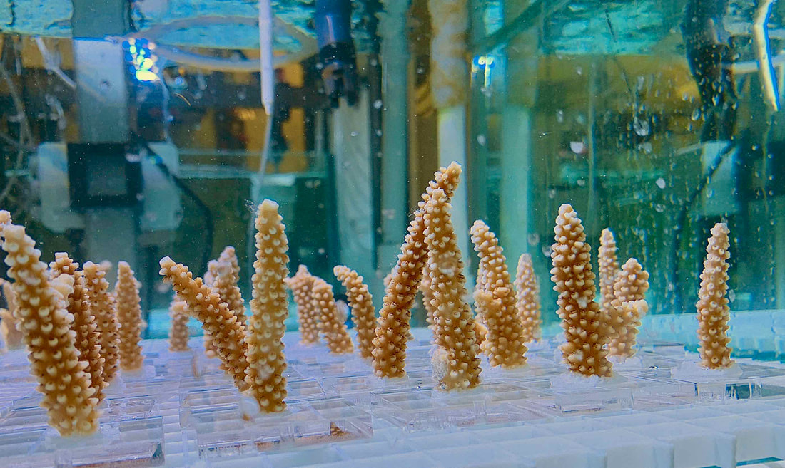{group="phd"}
:::

::: {.rphoto style="flex: 1.335 1 0"}
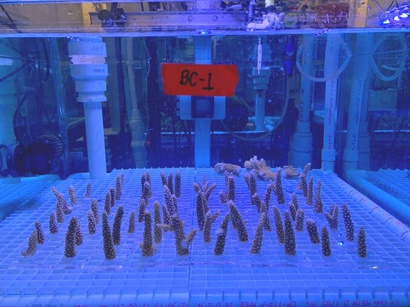{group="phd" description="Corals post-fragmenting, each on their individual tile with a randomly assigned number. The corals were given one week to acclimate in their new tanks!" fig-alt="Corals post-fragmenting, each on their individual tile with a randomly assigned number. The corals were given one week to acclimate in their new tanks!"}

[Corals post-fragmenting, each on their individual tile with a randomly assigned number. The corals were given one week to acclimate in their new tanks!]{.rcap}
:::

::: {.rphoto style="flex: 1.798 1 0"}
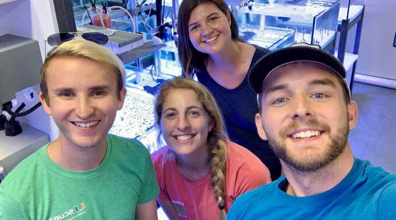{group="phd" description="Fragmenting team after making 370 fragments! Nash Soderberg, Isabelle Basden, Austin Schlenz, and myself (NOAA AOML ACCRETE Lab)" fig-alt="Fragmenting team after making 370 fragments! Nash Soderberg, Isabelle Basden, Austin Schlenz, and myself (NOAA AOML ACCRETE Lab)"}

[Fragmenting team after making 370 fragments! Nash Soderberg, Isabelle Basden, Austin Schlenz, and myself (NOAA AOML ACCRETE Lab)]{.rcap}
:::

:::::

::::: {.photo-row}

::: {.rphoto style="flex: 0.750 1 0"}
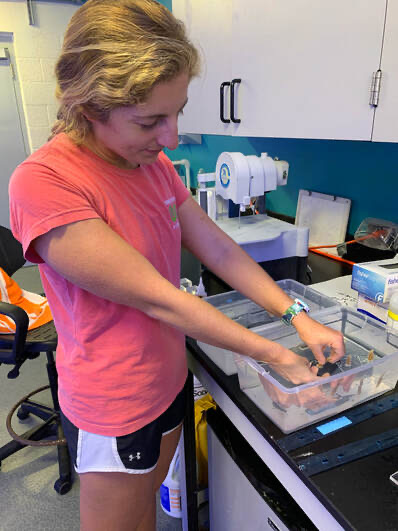{group="phd" description="We affixed the corals to their tiles using superglue. It cures quickly in water!" fig-alt="We affixed the corals to their tiles using superglue. It cures quickly in water!"}

[We affixed the corals to their tiles using superglue. It cures quickly in water!]{.rcap}
:::

::: {.rphoto style="flex: 0.779 1 0"}
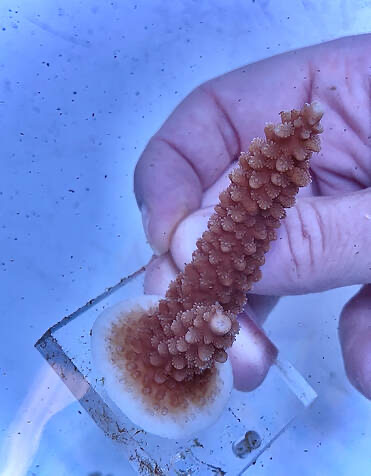{group="phd" description="A happy coral with its tentacles out. This photo was taken a few months after fragmenting - you can see at the bottom around the fragment a white, thin ring. This is the coral calcifying (and growing!) on its tile." fig-alt="A happy coral with its tentacles out. This photo was taken a few months after fragmenting - you can see at the bottom around the fragment a white, thin ring. This is the coral calcifying (and growing!) on its tile."}

[A happy coral with its tentacles out. This photo was taken a few months after fragmenting - you can see at the bottom around the fragment a white, thin ring. This is the coral calcifying (and growing!) on its tile.]{.rcap}
:::

::: {.rphoto style="flex: 0.751 1 0"}
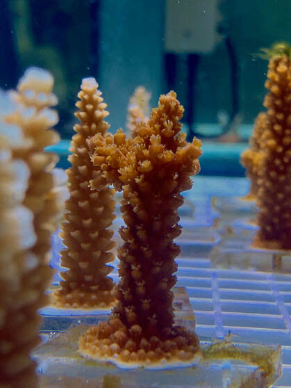{group="phd" description="A happy *Acropora cervicornis* fragment" fig-alt="A happy Acropora cervicornis fragment"}

[A happy *Acropora cervicornis* fragment]{.rcap}
:::

:::::

::::: {.photo-row}

::: {.rphoto style="flex: 1.620 1 0"}
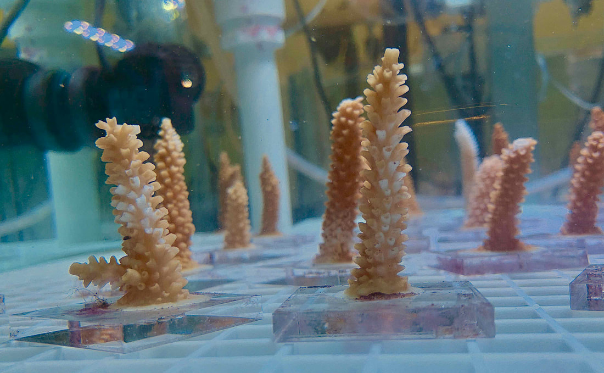{group="phd" description="Signs of stress - some paling and tissue loss on the corals" fig-alt="Signs of stress - some paling and tissue loss on the corals"}

[Signs of stress - some paling and tissue loss on the corals]{.rcap}
:::

::: {.rphoto style="flex: 0.802 1 0"}
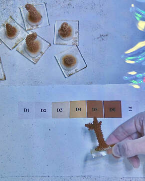{group="phd" description="The CoralWatch color scoring technique for assessing coral health" fig-alt="The CoralWatch color scoring technique for assessing coral health"}

[The CoralWatch color scoring technique for assessing coral health]{.rcap}
:::

::: {.rphoto style="flex: 1.020 1 0"}
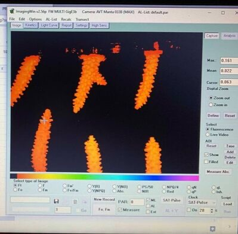{group="phd" description="Pulse amplitude-modulated (PAM) fluorometry used to measure the photochemical efficiency of the coral's algal symbionts." fig-alt="Pulse amplitude-modulated (PAM) fluorometry used to measure the photochemical efficiency of the coral's algal symbionts."}

[Pulse amplitude-modulated (PAM) fluorometry used to measure the photochemical efficiency of the coral's algal symbionts.]{.rcap}
:::

:::::
