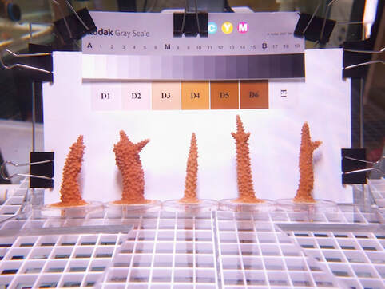
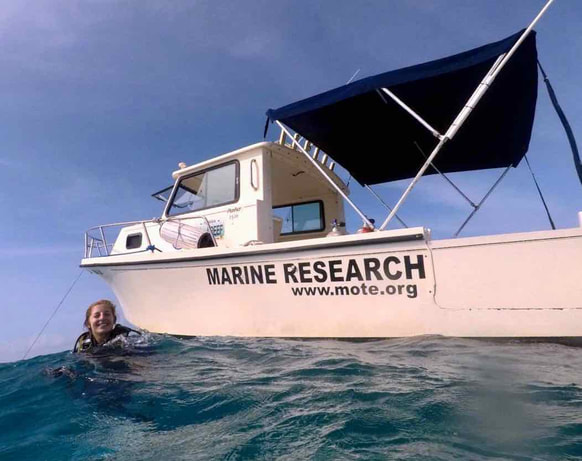

## Coral predation and restoration {#postdoc}

::: {.research-meta}
Assistant Scientist (2026–present) and Postdoctoral Research Associate (2025–2026) · University of Miami Rosenstiel School · [Dr. Diego Lirman](https://rescueareef.earth.miami.edu/)'s lab
:::

Millions of corals are being outplanted onto Florida's Coral Reef, but many are lost to corallivorous fish soon after they are planted. My research quantifies where, when, and how strongly fish predation affects outplanted corals, so that restoration practitioners can plan around it.

- **Coral-Baited Remote Underwater Video Systems (C-BRUVS).** Documenting fish corallivory on restored corals in Florida with underwater video.
- **A predation pressure index.** Co-PI on a Florida Department of Environmental Protection meta-analysis integrating field data to quantify corallivorous fish impacts on outplant success through a spatiotemporal predation pressure index.
- **Predictive tools and experimental validation.** As PI on a follow-up DEP project, I am integrating predation data into predictive tools and testing them in the field.
- **Next-generation coral restoration.** Part of a NOAA Transformational Habitat Restoration project implementing and scaling new approaches to increase the climate resilience of Florida's Coral Reef.
- **Reef-lined coasts.** Collaborator on the NSF Large-scale CoPE project reducing climate risks with equitable nature-based solutions.

## Enhancing coral thermal tolerance {#phd}

::: {.research-meta}
PhD, Marine Biology and Ecology · University of Miami · 2019–2024 · Advisors: [Dr. Ian Enochs](https://www.aoml.noaa.gov/coral-reef-ecosystems/) (NOAA AOML) and [Dr. Nikki Traylor-Knowles](https://www.cnidimmunitylab.com/) (UM)
:::

:::: {.columns}
::: {.column width="58%"}
My dissertation identified molecular pathways involved in thermal stress-hardening of Caribbean corals propagated for restoration in Florida. The goal was to understand the mechanisms of thermal priming so that assisted acclimatization could one day be used as a restoration technique.

We showed in [*Coral Reefs*](https://doi.org/10.1007/s00338-022-02232-z) that pre-exposure to a variable temperature treatment let the critically endangered staghorn coral, *Acropora cervicornis*, endure heat stress for days longer before bleaching. Follow-up work in [*Ecology and Evolution*](https://doi.org/10.1002/ece3.72108) found that the same treatment changed gene expression in *A. cervicornis* but not in *Pseudodiploria clivosa*, highlighting the need for species-specific approaches. I also studied *A. cervicornis* transplanted to a marginal, nearshore environment ([*Frontiers in Marine Science*](https://doi.org/10.3389/fmars.2026.1796814)).
:::
::: {.column width="4%"}
:::
::: {.column width="38%"}
{.rounded}

's nursery in Biscayne National Park. Photo by Nikki Besemer.](assets/img/nursery-collection.jpg){.rounded}
:::
::::

## Mote Marine Laboratory {#mote}

::: {.research-meta}
Coral Health and Disease Intern, then Research Intern · Summerland Key, FL · 2019 · Advisors: Dr. Hanna Koch and Dr. Abigail Clark
:::

:::: {.columns}
::: {.column width="58%"}
At Mote's International Center for Coral Reef Research and Restoration, I cared for thousands of corals in the ex-situ nursery, including *A. cervicornis* sexual recruits, and helped build Mote's first *in-situ* spawning nursery for *A. cervicornis*. I also extracted DNA from healthy and diseased corals for stony coral tissue loss disease (SCTLD) research.

For my independent project, I developed a protocol for measuring coral microfragment growth with a structured-light 3D scanner, published in [*Frontiers in Marine Science*](https://doi.org/10.3389/fmars.2021.623645).
:::
::: {.column width="4%"}
:::
::: {.column width="38%"}
{.rounded}
:::
::::
